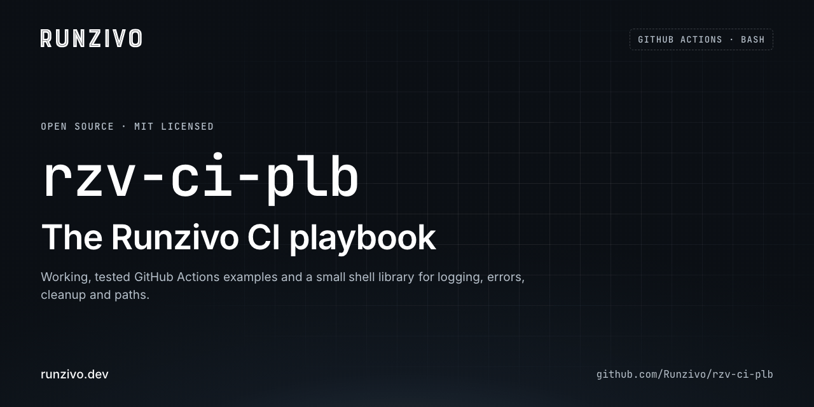

# rzv-ci-plb: the Runzivo CI playbook

<picture><source media="(prefers-reduced-motion: reduce)" srcset=".github/assets/poster.png"></picture>

Working, tested CI pipeline examples, starting with GitHub Actions (GitLab CI
is planned), plus a small shell library for logging, error handling, cleanup
and paths. Every example runs in this repository's own CI and on your machine.

MIT licensed. If it helps you, please star the repository; issues and pull requests are welcome.

## The rule

Keep workflow YAML declarative. A `run:` step holds at most three lines of
simple commands. Conditions, loops, retries, cleanup and error handling go
in a script that also runs locally. The ten standards built on this rule
are in [docs/best-practices.md](docs/best-practices.md).

## Examples

| Stack | Code | Workflow |
| --- | --- | --- |
| Node.js | [examples/nodejs](examples/nodejs) | [example-nodejs.yml](.github/workflows/example-nodejs.yml) |
| Python | [examples/python](examples/python) | [example-python.yml](.github/workflows/example-python.yml) |
| Go | [examples/golang](examples/golang) | [example-golang.yml](.github/workflows/example-golang.yml) |
| Docker | [examples/docker](examples/docker) | [example-docker.yml](.github/workflows/example-docker.yml) |
| Runzivo runners | [examples/runzivo-runners](examples/runzivo-runners) | [runzivo.yml](.github/workflows/runzivo.yml) |

[ci.yml](.github/workflows/ci.yml) runs each example on `ubuntu-latest`.
[runzivo.yml](.github/workflows/runzivo.yml) runs the same jobs on a Runzivo
runner when the `RUNZIVO_RUNNER_LABEL` repository variable is set.

## Copy and use

1. Copy [`scripts/lib/`](scripts/lib) into your repository.
2. Copy the example directory for your stack and its workflow file.
3. Point the `LIB_DIR` line in the example's `ci/*.sh` at your `scripts/lib`.
4. Replace `workflow_call` in the workflow with your triggers.
5. Run the script locally, then the checks below.

## Run the checks

```bash
brew install actionlint shellcheck shfmt bats-core zizmor   # macOS
bash scripts/ci/01-validate.sh        # actionlint, shellcheck, shfmt, zizmor
bash scripts/ci/02-test.sh            # Bats tests and every example
bash scripts/ci/02-test.sh golang     # one suite
```

CI installs pinned, checksum-verified versions with
[scripts/ci/00-install-tools.sh](scripts/ci/00-install-tools.sh).

## More

- [AGENTS.md](AGENTS.md): instructions for AI coding agents
- [docs/security.md](docs/security.md), [docs/environments.md](docs/environments.md),
  [docs/troubleshooting.md](docs/troubleshooting.md)
- [docs/ai-agent-guide.md](docs/ai-agent-guide.md): agents and credentials
- [CONTRIBUTING.md](CONTRIBUTING.md) and [SECURITY.md](SECURITY.md)

Terraform and Ansible examples are planned and will use the same library and layout.
